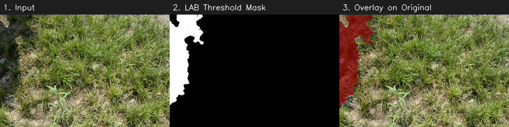
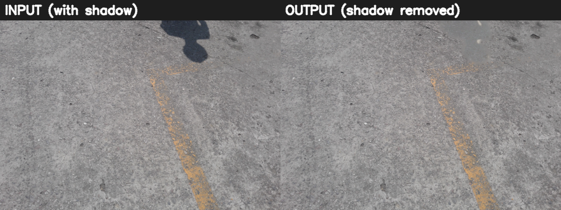
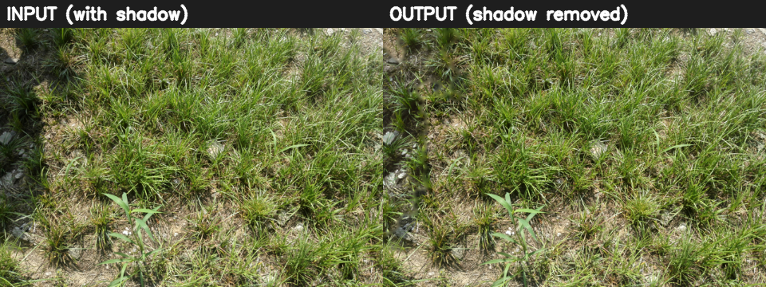

# Shadow Detection and Removal in Outdoor Images

Image Processing coursework project. Detects shadows in a single outdoor photo using LAB and YCbCr color space analysis, then removes them with illumination relighting and boundary blending. No training data and no GPU are needed.



## Results

Input on the left, output on the right. Test images are from the ISTD dataset.




Quantitative results (IoU, F1, RMSE, SSIM on the ISTD test split) are produced by `evaluate.py`. Run it and add your numbers here.

## How it works

1. **Detect.** Convert to LAB. Threshold on L (or L + a + b for strongly colored scenes) at `mean - std / 3`, following Murali and Govindan (2013).
2. **Clean the mask.** Morphological open and close, then keep only connected regions that are large enough and at least 15% of the largest region. This stops grass or gravel texture from being read as shadow. A YCbCr check removes dark non-shadow pixels.
3. **Relight.** For each LAB channel, rescale the shadow pixels to the mean and spread of a ring of lit pixels just outside the shadow.
4. **Blend.** Inpaint (Telea) a thin band along the shadow boundary to hide the seam.

## Setup

```bash
pip install -r requirements.txt
```

## Usage

Run on one image or a folder:

```bash
python make_sample.py                      # optional: makes samples/synthetic1.jpg
python main.py --input samples --outdir outputs
```

Each image gets its own folder in `outputs/` with `01_original.png`, `02_shadow_mask.png`, `03_mask_overlay.png` and `04_result.png`.

Evaluate on ISTD (download the dataset separately, it is not included here):

```bash
python evaluate.py --istd_root path/to/ISTD_Dataset --split test --limit 30
```

This reports IoU and F1 for the mask, and RMSE and SSIM for the result, and writes `evaluation_results.csv`.

## Browser version

`web/index.html` is a single-file web app (Umbra) that runs the same pipeline in JavaScript on a canvas. Photos never leave the device. Open the file in a browser to use it. It blurs the seam instead of using Telea inpainting.

## Project layout

```
src/detect_shadow.py   LAB detection, mask cleanup, YCbCr check
src/remove_shadow.py   relighting and boundary inpainting
main.py                command line pipeline
evaluate.py            benchmark against ISTD
make_sample.py         synthetic test image
web/index.html         browser version
docs/                  project presentation
```

## Limitations

Works best with one dominant, hard shadow on a fairly uniform surface. Many small shadows or shadows across several materials are corrected only partly, and a faint outline can remain. Dark non-shadow objects can be marked as shadow.

## References

- Murali, S. and Govindan, V.K. Shadow Detection and Removal from a Single Image Using LAB Color Space. Cybernetics and Information Technologies, 2013.
- Wang, J., Li, X. and Yang, J. Stacked Conditional GAN for Shadow Detection and Removal (ISTD dataset). CVPR 2018.
- Telea, A. An Image Inpainting Technique Based on the Fast Marching Method. 2004.

## License

MIT
